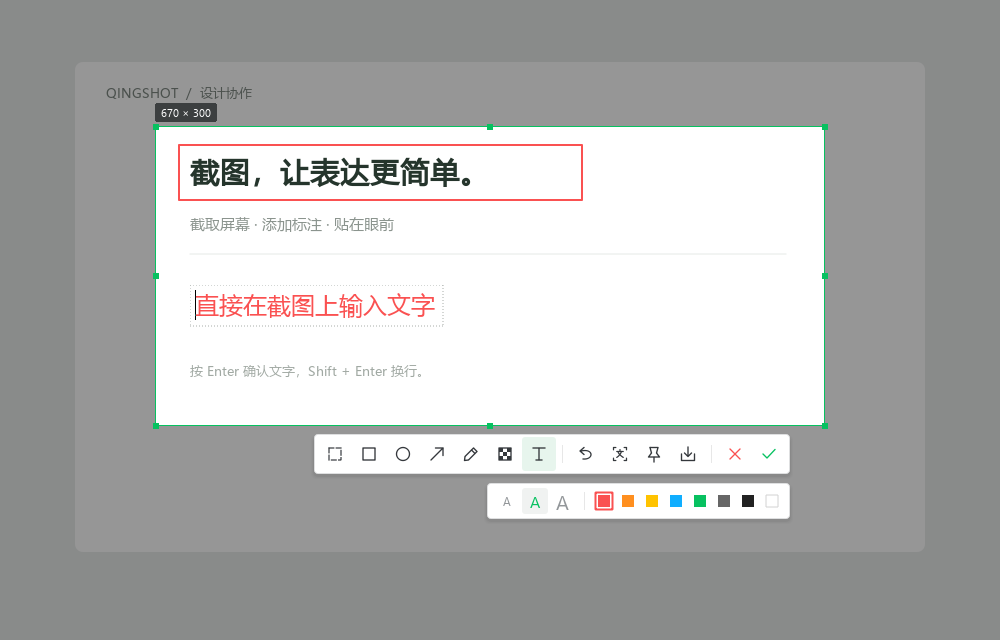

# QingShot · 轻映

A Windows screenshot tool built with Python and PySide6: annotate a selection, pin an image to the desktop, and recognize text locally.

[中文说明](README.md) · [Issues](https://github.com/songxinj/qingshot/issues) · [Contributing](CONTRIBUTING.md)

[](https://github.com/songxinj/qingshot/actions/workflows/ci.yml)

**Version 0.2.1 · Alpha · MIT license.** Requires Windows 10/11 and Python 3.11 or newer. A standalone executable is not currently provided.



## Features

- Select a screen region and add rectangles, ellipses, arrows, freehand strokes, text, or mosaic annotations.
- Edit text directly on the image, change colors and sizes, and undo annotations.
- Pin images above other windows, drag them, zoom with the mouse wheel, and adjust opacity with Ctrl + wheel.
- Recognize text locally using RapidOCR, with Windows OCR as a fallback.
- Review and edit recognized text before requesting an online translation.
- Customize shortcuts and retain screenshot history locally.

## Quick start

Clone or download the repository, then run these commands from its root:

```powershell
python -m venv .venv
.venv\Scripts\python -m pip install -e .
.venv\Scripts\python app.py
```

After installation, you can also launch `.venv\Scripts\qingshot` or double-click `start.cmd`. The script prefers a project `.venv` when present and otherwise uses the system Python.

Press **Ctrl + Alt + A** to capture a region. If another application owns this shortcut, change it in preferences. Exit the previous version from the system tray before restarting an updated checkout.

## Privacy and local data

Screenshots and OCR are processed locally. **Clicking Translate sends the source text to Google; a connection failure falls back to MyMemory, so the same text may reach both providers.** Images are not included in these translation requests. Use only local capture and OCR when handling confidential content.

Screenshot history is saved as ordinary PNG files by default. You can turn off automatic saving; existing files remain. History is not encrypted or automatically deleted.

Source checkouts use `data/`. Installed packages use `%LOCALAPPDATA%/QingShot/`, or retain an existing `%LOCALAPPDATA%/QingCapture/` directory. `QINGSHOT_DATA` overrides the location; the legacy `QINGCAPTURE_DATA` variable remains supported.

Read [SECURITY.md](SECURITY.md) for the security and privacy notes.

## Development and verification

```powershell
.venv\Scripts\python -m pip install -e ".[dev]"
.venv\Scripts\python -m ruff check .
.venv\Scripts\python -m ruff format --check .
.venv\Scripts\python -m unittest discover -s tests -p "test_*.py" -v
```

Windows CI covers Python 3.11 and 3.12, linting, tests, wheel building, and installed-process activation and restart. External-service tests require `QINGSHOT_INTEGRATION=1` and are skipped by default.

Mixed-DPI multi-monitor setups, HDR, and remote desktop environments still need broader hardware validation. Generated documentation previews are not evidence of successful live desktop capture.

See the [architecture](docs/architecture.md), [verification notes](docs/verification.md), and [contribution guide](CONTRIBUTING.md). The current application UI and most development documentation are in Chinese.

If QingShot is useful to you, consider starring the repository or opening an issue with a concrete use case or reproducible problem.

## License

Project code is licensed under [MIT](LICENSE). Third-party components retain their own licenses; see [THIRD_PARTY_NOTICES.md](THIRD_PARTY_NOTICES.md).
