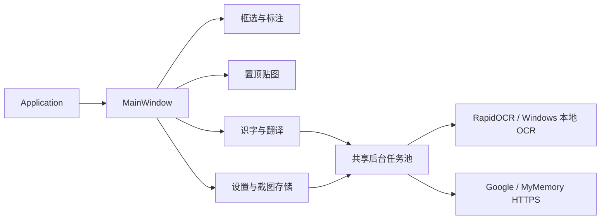

# 架构与性能边界

`application.py` 处理启动、单实例和异常日志，`main_window.py` 负责界面动作与功能协调。`overlay.py`、`pin.py` 和 `translation_dialog.py` 管理各自的交互状态。服务模块不依赖主窗口。

## 线程与资源

- GUI 线程只负责窗口、QPixmap、剪贴板和绘制。
- TaskRunner 共享一个最多 2 线程的池，最多持有 8 个待完成任务，防止重复点击造成无限排队。
- 启动先沿用本地 socket 唤醒已有实例，再通过用户临时目录中的 QLockFile 原子确认实例归属；锁保持到服务端关闭，避免 Windows 同名管道允许多服务端导致的并发启动竞争。
- 识字与翻译窗口忙碌时统一阻止关闭、Esc、accept/reject；若控件被外部销毁，迟到的结果不会继续更新已释放的控件。
- 自动保存先取得隐式共享的 QImage，再在后台编码 PNG 和写盘；完成信号回到主线程更新记录。
- 历史枚举使用文件名和 `heapq.nlargest`，最多返回 200 条，不为排序解码图片。
- 历史枚举也在后台执行；请求使用递增序号，忽略晚到的旧结果，避免连续刷新覆盖新记录。
- 只有可见的历史记录才请求缩略图，每次最多处理 2 张；缩略图使用 QImageReader 缩放读取。
- 缩略图缓存最多 64 张，180×100 的 32 位图像数据上限约 4.4 MiB，不含 Qt 对象开销。截图原图和桌面底图不包含在这个上限内。
- 截图遮罩层预合成一份暗色背景底图以减少每帧全屏半透明混合（以一张全屏底图内存换取拖动帧率，例如 3840×2160 约占 31.6 MiB 像素数据），选区内部直接按 `(0, 0)` 原点裁剪绘制原图，避免非整数 DPR 下的子像素重采样抖动；已落笔的马赛克区域按源矩形缓存降采样结果（正在拖动的当前马赛克框仍随尺寸变化实时重算）。
- 主窗口预览区按 `(cacheKey, 可用尺寸)` 缓存平滑缩放后的 `QPixmap`，并按 `deviceIndependentSize()` 逻辑尺寸居中绘制。
- 快捷键配置经过规范化（含 `Print` → `PrintScreen` 映射）与动作间冲突检查；Windows 全局热键改绑采用可回退策略，新热键注册失败时自动恢复原已注册热键且不持久化失败值。
- OCR 输入长边缩小至最多 2400 像素；本地桥接超时为 35 秒。
- 翻译每段最多 480 个 UTF-8 字节，单次原文最多 12 KB；单次网络调用超时参数最多 18 秒，总请求预算 60 秒。业务预算到期后及时返回错误，不再等待线程池上下文结束。
- 多行翻译保留既有段落重排与内容去重；复用进程级最多 3 个 HTTP 工作线程和 3 个提交许可。超时后的在途请求不强制杀线程，许可到请求真正结束才释放，因此重试不能突破并发上限；底层网络结束时间仍受操作系统网络超时影响。

## 坐标与绘制

选区和标注使用 Qt 逻辑坐标；合成底图及导出使用最高显示器 DPR。移动选区时同步平移标注，改变大小时裁剪到新选区。马赛克对选定底图块降采样后使用最近邻绘制。

底图尺寸随桌面总面积和最高 DPR 增长。多块 4K 显示器可能占用较多内存；当前没有跨屏混合 DPI 硬件实测。画笔路径按输入点保存，极长笔迹仍可能增加重绘耗时。

## 验证层次

1. `tests/test_app.py`：框选事件、DPI、标注导出、贴图和剪贴板。
2. `tests/test_storage.py`：损坏配置、历史数量边界、错误返回、任务池与界面响应。
3. `tests/test_desktop.py --fixture`：注入程序生成的截图底图，运行真实界面动作、Windows OCR、联网翻译、贴图与新进程配置读取。
4. `tests/test_desktop.py`：真实桌面抓屏；执行环境全黑时明确报告 SKIP，不算通过。
5. `benchmarks/benchmark.py`：输出历史枚举、历史界面刷新和带标注导出的本机耗时。

界面渲染、逻辑和 OCR / 网络链路可以独立验证。CI 只运行不依赖交互桌面和第三方服务的测试；历史验证结果及硬件覆盖限制见 [验证说明](verification.md)。
