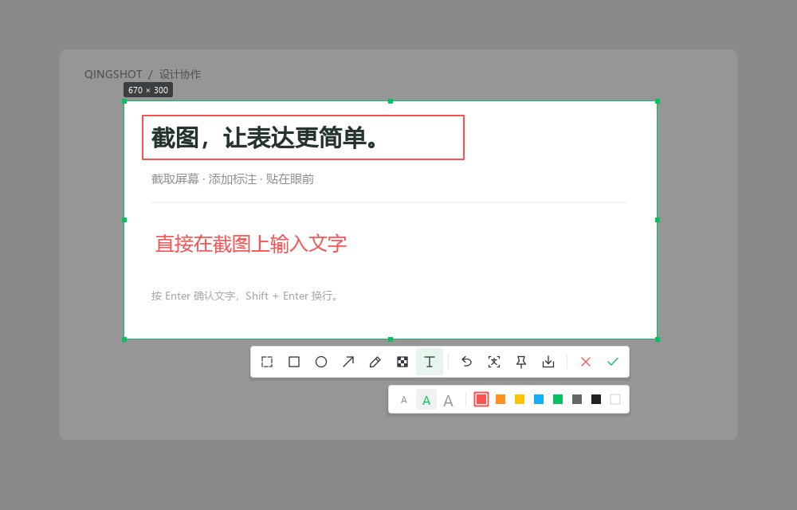
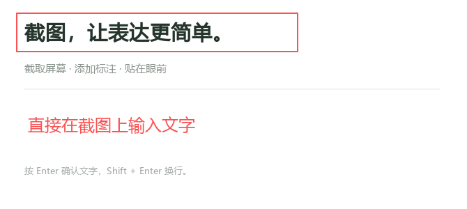
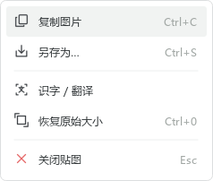

# 界面与交互

截图工具栏采用单排图标、浅色分隔线及按需展开的标注选项。图标由代码绘制，项目不分发微信商标或界面资源。

## 框选与标注

- 拖动选区内部移动选区，拖动边缘控制点调整大小。
- 矩形、圆形、箭头、画笔、文字及马赛克共用颜色和尺寸选项；选中标注工具时显示选项条。
- 文字直接在图上输入：Enter 确认、Shift+Enter 换行、Esc 放弃当前文字。编辑时 Ctrl+C / Ctrl+Z 操作文字本身。
- 工具栏和选项条根据可见区域调整位置，减少靠近屏幕边缘时被遮挡的情况。






## 贴图菜单

贴图使用置顶窗口，右键菜单提供复制、保存、识字/翻译以及恢复大小和透明度。菜单保留 QAction 的键盘操作。



## 识字与翻译

识别后的原文可编辑，OCR 不改动已选目标语言。自动判断按内容区分中英混排，并保留换行、空行及缩进；重复内容复用翻译请求，最多同时执行 3 个 HTTP 请求。

原文和目标语言相同，或第三方服务只返回原文时，界面会提示调整或报告未生成译文。自动语言判断采用文字特征，复杂混排可手动指定语言。数据去向见 [安全与隐私](../SECURITY.md)。

## 重新生成预览

在安装运行依赖后执行：

```powershell
python tools/render_ui.py
```

以上四张预览由真实 Qt 组件在程序生成的测试文档上渲染，输出到 `docs/assets/`。它们不包含用户屏幕内容，也不作为真实桌面采集的验证证据。
